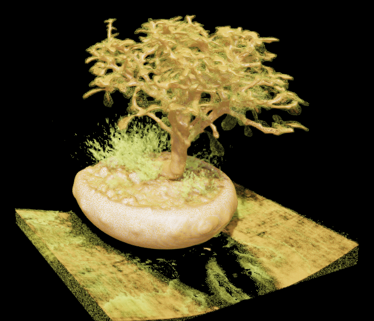

# Volume Rendering using Ray Casting

An interactive GPU volume renderer for 8 and 16 bit raw volumes, classified by an editable transfer function. The
volume lights itself with soft shadows, ambient occlusion and one bounce of indirect light.

Made with **C++20**, **OpenGL 4.3**, [Cinder](https://libcinder.org) and [Dear ImGui](https://github.com/ocornut/imgui).
[StyleTransferFunction](https://github.com/jose-villegas/StyleTransferFunction) grew out of this project and adds
lit sphere styles on top.


| Bonsai | Foot | Skull |
|---|---|---|
|  |  |  |

## Features

- Alpha and color points on a transfer function editor over the volume's histogram.
- Volumetric lighting, switchable against the original classic lighting.
- Histogram and gradients in compute shaders.
- ACES tone mapping and FXAA, or straight to the screen.


How it all works, with the lighting model and the command line options: [docs/implementation.md](docs/implementation.md).

## Building

Windows, Visual Studio 2026 with the *Desktop development with C++* workload, and a GPU with OpenGL 4.3.

```bash
git clone -c core.longpaths=true --recurse-submodules https://github.com/jose-villegas/VolumeRendering.git
```

Open `VolumeRendering.sln` and build `Release|x64`. Cinder is a submodule and builds with the solution. Run the app
from the `VolumeRendering` project folder, which Visual Studio does by default.

## Usage

*File → Open* loads a raw volume. The *Volume* menu opens the tool windows. Drag to orbit, scroll to zoom.

The bundled volumes load with a tuned transfer function from the command line:

```bash
cd VolumeRendering && ../x64/Release/VolumeRendering.exe --preset skull --ui
```

## Datasets

From the [Open SciVis Datasets](https://klacansky.com/open-scivis-datasets/) collection:

- Bonsai: CT scan of a bonsai tree, S. Roettger, VIS, University of Stuttgart.
- Foot: rotational C-arm x-ray scan of a human foot, Philips Research, Hamburg, Germany.
- Skull: rotational C-arm x-ray scan of a phantom of a human skull, Siemens Medical Solutions, Forchheim, Germany.
