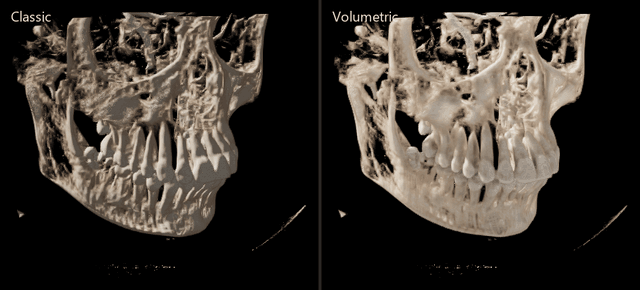
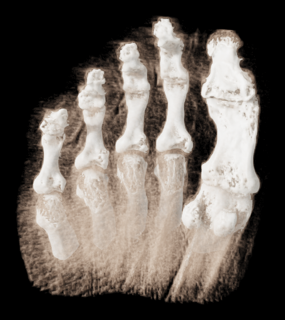
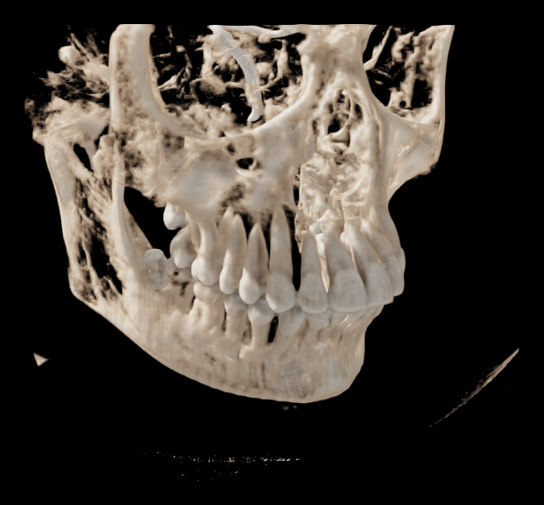
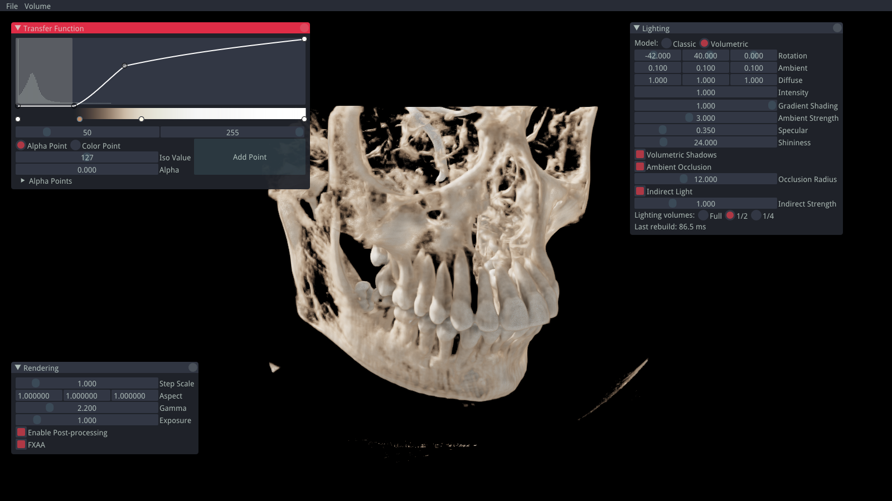
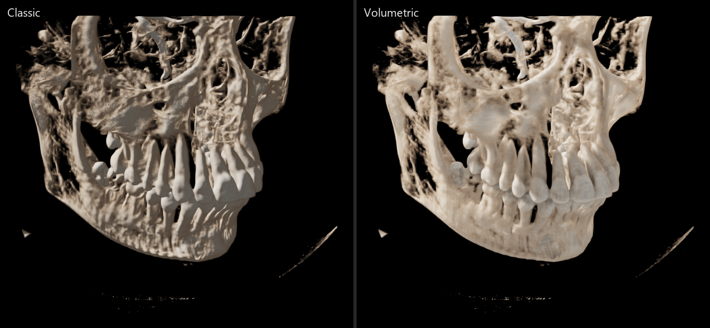
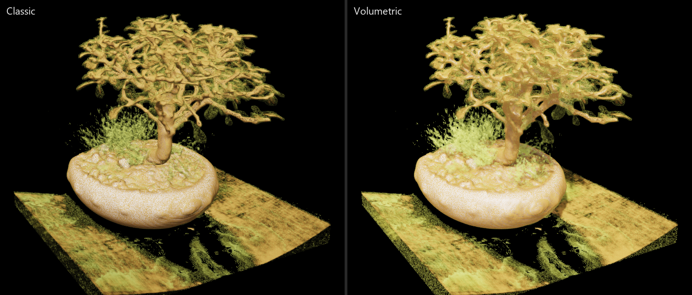

# Volume Rendering using Ray Casting

An interactive GPU volume renderer for 8 and 16 bit raw volumes. Rays are cast through the volume and classified by
an editable transfer function. Lighting comes from the volume itself: soft shadows, ambient occlusion and one bounce
of indirect light, computed in compute shaders.

Made with **C++20**, **OpenGL 4.3**, [Cinder](https://libcinder.org) and [Dear ImGui](https://github.com/ocornut/imgui).
[StyleTransferFunction](https://github.com/jose-villegas/StyleTransferFunction) grew out of this project and adds
lit sphere styles on top.



| Bonsai | Foot | Skull |
|---|---|---|
|  |  |  |

## Features

- **Transfer function editor** over the volume's histogram, with alpha and color control points interpolated by
  cubic splines and an iso value threshold.
- **Ray casting** with jittered start positions to hide banding, opacity correction for the step size, early ray
  termination and per axis aspect ratios.
- **Histogram and gradients** computed in compute shaders. Gradients are central differences smoothed by a separable
  5×5×5 binomial filter. Their magnitude is kept, so shading can tell surfaces from homogeneous regions.
- **Volumetric lighting** (the default), see below, switchable against the original *classic* Lambert lighting in
  the *Lighting* window.
- **Post-processing:** ACES tone mapping, gamma, exposure and FXAA. It can be turned off to ray cast straight to the
  screen with exponential tone mapping.



## Lighting

Classic lighting is Lambert plus a constant ambient term. Every sample is lit as if nothing stood between it and the
light. Volumetric lighting computes light inside the volume, so whatever stands in front blocks it, at any depth.





Two 3D textures, built by compute shaders at half the volume resolution by default:

- **Light volume.** Transmittance toward the directional light, marched from every voxel through the classified
  volume:

  ```math
  T_l(\mathbf{x}) = \prod_i \left(1 - \alpha(\mathbf{x} + i\,\Delta\mathbf{l})\right)
  ```

- **Ambient volume.** Every voxel marches 16 short rays (Fibonacci sphere directions, 12 voxels long by default).
  The fraction of rays that escape is the ambient visibility $`V`$. The material each ray runs into, lit by the light
  volume, is reflected back as one bounce of indirect light $`E`$:

  ```math
  V(\mathbf{x}) = \frac{1}{16} \sum_{d=1}^{16} T_d, \qquad
  E(\mathbf{x}) = \frac{1}{16} \sum_{d=1}^{16} \sum_i T_{d,i}\, \alpha_i\, \mathbf{c}_i\, T_l(\mathbf{x}_i)
  ```

Each sample along a view ray then combines them with its transfer function color $`\mathbf{c}`$:

```math
L = \mathbf{c} \left[ L_d \left( \left(1 - s + s\,\max(0, \mathbf{n}\cdot\mathbf{l})\right) T_l + E \right) + k_a L_a \min(2V, 1) \right]
  + L_d\, s\, k_s \frac{p + 8}{8\pi} \max(0, \mathbf{n}\cdot\mathbf{h})^p\, T_l
```

$`s`$ fades from 1 on surfaces to 0 in homogeneous regions, following the gradient magnitude. Where the normal is only
noise, samples scatter light like a medium instead of shading as a surface. A point on an open, flat surface sees half
of the sphere blocked, hence $`\min(2V, 1)`$.

The two volumes are rebuilt only when the light, the volume's rotation, the threshold or the transfer function
change. Moving the camera costs nothing extra. Every term has its own toggle and strength in the *Lighting* window,
and the window reports how long the last rebuild took.

On an AMD Radeon 610M (integrated) at 1280×720, the skull renders at about 24 ms per frame with volumetric lighting
and 21 ms with classic lighting. A rebuild of both lighting volumes for a 256³ volume takes about 95 ms at half
resolution.

## Building

Requires Windows, Visual Studio 2026 with the *Desktop development with C++* workload (toolset v145, Windows 10/11
SDK) and a GPU with OpenGL 4.3.

```bash
git clone -c core.longpaths=true --recurse-submodules https://github.com/jose-villegas/VolumeRendering.git
```

Open `VolumeRendering.sln` and build `Release|x64` or `Debug|x64`. Cinder is a submodule and builds with the
solution, which takes a few minutes the first time. `Directory.Build.props` selects the v145 toolset for every
project. Shaders, fonts and images load relative to the working directory, so run the app from the `VolumeRendering`
project folder, which is what Visual Studio does by default.

## Usage

*File → Open* loads a raw volume: give its dimensions, aspect ratio and bit depth. The *Volume* menu opens the
transfer function, lighting, rendering and rotation windows. Drag to orbit, scroll to zoom.

Three 256³ volumes are in `volumes/`. A command line harness loads them with a tuned transfer function, and also
drives captures and smoke tests. Without arguments the app starts empty as before.

```bash
cd VolumeRendering && ../x64/Release/VolumeRendering.exe --preset skull --lighting classic
```

| Option | Effect |
|---|---|
| `--preset bonsai\|skull\|foot` | load a bundled volume with its transfer function and framing |
| `--volume <raw> --dims X,Y,Z` | load any raw volume, with `--16bit` and `--aspect X,Y,Z` |
| `--lighting classic\|volumetric` | lighting model |
| `--off shadows\|occlusion\|indirect\|specular\|gradient` | turn one volumetric term off, repeatable |
| `--light RX,RY,RZ`, `--intensity I`, `--ambient A` | light rotation in degrees, intensity, ambient strength |
| `--rotate RX,RY,RZ`, `--threshold MIN,MAX` | volume rotation, iso value range |
| `--camera YAW,PITCH,DISTANCE` | orbit camera position |
| `--size W,H`, `--ui`, `--no-ui`, `--direct` | window size, open the tool windows, hide every window, skip post-processing |
| `--frames N`, `--warmup N`, `--capture <dir>` | render N frames after warm up, save each as a png, then quit |
| `--orbit D`, `--light-orbit D`, `--compare N` | animate camera or light by D degrees per frame, switch models every N frames |

## Datasets

From the [Open SciVis Datasets](https://klacansky.com/open-scivis-datasets/) collection:

- Bonsai: CT scan of a bonsai tree, S. Roettger, VIS, University of Stuttgart.
- Foot: rotational C-arm x-ray scan of a human foot, Philips Research, Hamburg, Germany.
- Skull: rotational C-arm x-ray scan of a phantom of a human skull, Siemens Medical Solutions, Forchheim, Germany.
